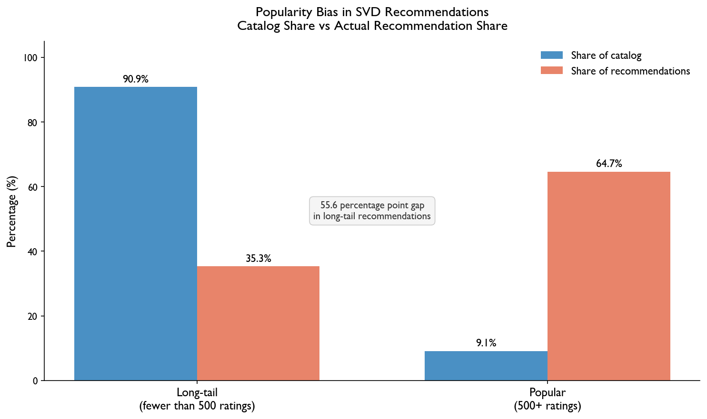

# Beyond the Top 10: Exploring Popularity Bias in Movie Recommendations

## The Question

Do movie recommendations give lesser-rated films much exposure? This project examines that question using MovieLens ratings and an SVD recommendation model.

## The Approach

I used SQL and DuckDB to examine MovieLens 25M, then selected 6,155,371 ratings from the 5,000 most active users. I trained the model on 80% of these ratings and tested its rating predictions on the remaining 20%.

For 500 users, I compared top-10 recommendation lists before and after adding a 0.2 ranking-score boost to movies with fewer than 500 ratings.

## The Findings

Movies with at least 500 ratings represented 9.1% of the rated-movie catalog but received 64.7% of the original recommendation slots. Lesser-rated movies represented 90.9% of that catalog and received 35.3% of recommendation slots.

After re-ranking, lesser-rated movies received 75.9% of recommendation slots, an increase of 40.6 percentage points based on the rounded results. This shows that a simple scoring adjustment can change which movies receive exposure without retraining the model.

These results describe this offline experiment, not Netflix or Hulu. The comparison does not establish that users prefer the adjusted recommendations; that would require further evaluation.

## Chart

**Figure 1.** Catalog share versus baseline recommendation share. The catalog comparison includes only movies with at least one rating. Recommendation share counts slots across the 500 users' top-10 lists, not distinct titles.
